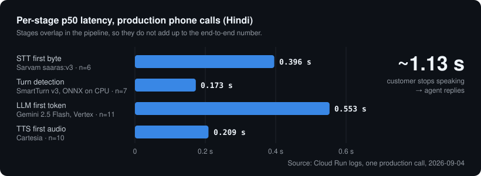
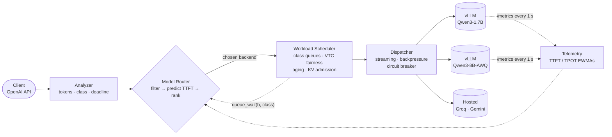

  

  

  
  
  

---

  

🌐 <b>Portfolio:</b> <a href="https://jashan-ai-sys.github.io/">jashan-ai-sys.github.io</a>: case studies and how to hire me for AI voice agents, chatbots and automation

---

## 🚀 Featured projects

<table>
<tr>
<td width="50%" valign="top">

### 📞 [Dunning Agent](https://github.com/Jashan-ai-sys/dunning-agent)
**Voice AI for revenue recovery** · Razorpay AI Buildathon

Detects failed subscription payments and **calls customers in Hindi** over Twilio. During the call it can send a payment link or re-authorise a mandate. It runs live on Cloud Run, with **~1.13 s** from the moment the customer stops speaking to the agent's reply.

`Pipecat` `Twilio` `Gemini` `MCP` `Cloud Run`

</td>
<td width="50%" valign="top">

### ⚡ [Inference Gateway](https://github.com/Jashan-ai-sys/inference-gateway)
**LLM routing + scheduling** · in progress

An OpenAI-compatible gateway in front of vLLM and hosted APIs. Its router picks the backend from cost, quality and predicted latency, and its scheduler orders requests by deadline, tenant fairness and KV-cache headroom. A benchmark on an L4 GPU is in progress.

`vLLM` `FastAPI` `Prometheus` `Terraform` `AWS`

</td>
</tr>
<tr>
<td width="50%" valign="top">

### 🛒 [ShopWave Multi-Agent Support](https://github.com/Jashan-ai-sys/ShopWave-MultiAgent-Customer-Support-System)
**Agentic customer support** · Ksolves Agentic AI Hackathon

A self-correcting pipeline that runs risk analysis, then a planner, a validator, an MCP executor and a responder, with a reflection loop when a tool fails and a dead-letter queue.

`Gemini` `MCP` `Python`

</td>
<td width="50%" valign="top">

### 🧠 [AI Sales Call Intelligence](https://github.com/Jashan-ai-sys/AI-Sales-Call-Intelligence-System)
**Speech → insights**

Turns a call recording into a transcript, extracts intent, sentiment and objections, flags "magic moments", writes LLM coaching and runs a RAG search over past calls.

`Whisper` `spaCy` `Llama 3.3` `ChromaDB`

</td>
</tr>
<tr>
<td width="50%" valign="top">

### 💊 [PharmaConnect](https://github.com/Jashan-ai-sys/pharmaconnect-prototype)
**Pharmacy platform** · Centific Hackathon

A POS with role-based access, FEFO stock depletion and atomic billing. When a drug is out of stock, an AI engine suggests a substitute for the pharmacist to approve.

`FastAPI` `SQLAlchemy` `JWT`

</td>
<td width="50%" valign="top">

### 🍯 [Agentic Honey-Pot](https://github.com/Jashan-ai-sys/Agentic-Honey-Pot-for-Scam-Detection-Intelligence-Extraction)
**Scam intelligence** · GUVI Hackathon

A persona agent that keeps scammers talking and extracts their UPI IDs, URLs and phone numbers for reporting.

`FastAPI` `LLM agents`

</td>
</tr>
</table>

<b>More repos</b>

 

| Project | What it is |
|---|---|
| [Portfolio](https://github.com/Jashan-ai-sys/Jashan-ai-sys.github.io) | My freelance site for AI voice agents, chatbots and automation (React, Tailwind, three.js) |
| [LeetCode → GitHub](https://github.com/Jashan-ai-sys/LeetCode-to-GitHub-Automation) | Syncs my accepted LeetCode submissions to GitHub, sorted by difficulty |
| [Telecom Revenue Analysis](https://github.com/Jashan-ai-sys/Telecom-Customer-Billing-and-Revenue-Analysis) | Revenue drivers, service bundling, hypothesis tests and outliers (Pandas, SciPy, statsmodels) |

---

## 🔍 Deep dives

<b>📞 Dunning Agent: where the 1.13 s goes</b>

 

  

- **The model can't invent an outcome.** The conversation is a graph. The LLM picks an edge label, and the code refuses any label that isn't legal at the current node.
- **The agent can't name a case.** Its MCP tools take no arguments, and the code injects the case where the model can't reach it.
- **Nobody is called twice about the same debt.** This is enforced with `FOR UPDATE SKIP LOCKED` and a concurrency test.

<b>⚡ Inference Gateway: how a request is placed</b>

 

The router reads the scheduler's predicted queue wait. When an interactive request would miss its deadline on the local GPU, it overflows to a hosted API. The gateway core is merged with 133 tests. The benchmark compares six places scheduling could live, from FIFO passthrough to vLLM-native priority to separate replica pools, and its results will be published with confidence intervals.

---

## 🛠️ Tech stack

**AI & LLMs** 

**Voice AI** 

**Backend** 

**Cloud & ops** 

**ML & data** 

---

## 📈 GitHub activity

  

<picture>
  <source media="(prefers-color-scheme: dark)" srcset="https://raw.githubusercontent.com/Jashan-ai-sys/Jashan-ai-sys/output/snake-dark.svg"/>
  <source media="(prefers-color-scheme: light)" srcset="https://raw.githubusercontent.com/Jashan-ai-sys/Jashan-ai-sys/output/snake.svg"/>
  
</picture>

---

  <b>Let's build something.</b>  
  
  
  

